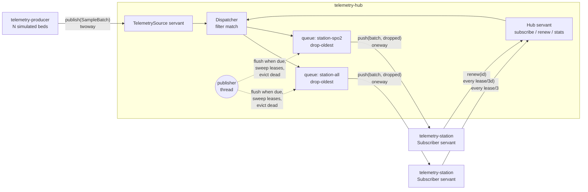

# telemetry-orb

Real-time patient telemonitoring over CORBA: IDL-defined telemetry service, push-model subscriptions with per-subscriber QoS, and a central monitoring station client.


> Not a medical device. For engineering demonstration only. All vital signs are synthetic, generated by a random-walk model.

See also: [bedside-link](https://github.com/pgallo/bedside-link), the device side of the same story (an Object Pascal gateway that parses bedside monitor, ventilator and infusion pump streams and normalises them to HL7 v2 observations, the kind of producer that feeds this hub).

## What it demonstrates

- An IDL contract (`idl/Telemetry.idl`) with structs, sequences, an enum, user exceptions and three interfaces: `TelemetrySource` for producers, `Subscriber` as a callback implemented by stations, and `Hub` for subscribe, lease renewal, unsubscribe and per-subscription stats.
- Push-model fan-out with oneway delivery: each subscription has its own bounded queue at the hub with a drop-oldest overflow policy, batching by size and age, a per-subscriber rate cap, and the drop count carried in every push.
- A dedicated publisher thread that never holds the registry lock during a remote call, so publishing and subscribing are never blocked behind a slow or dead station.
- Failure handling by exception type: `OBJECT_NOT_EXIST` and `COMM_FAILURE` evict at once, `TRANSIENT` and `TIMEOUT` count toward a threshold, the ORB's built-in retry loop is disabled per reference, and pushes have a call timeout.
- Leases: the hub clamps the requested lease, sweeps expired ones each cycle, and the station renews at a third of the granted lease and resubscribes on its own when the hub reports it as unknown.
- POA servants on a child POA with `PERSISTENT` and `USER_ID` policies, so references survive a hub restart on a fixed endpoint; IOR-file bootstrap by default and the Naming Service as an option.
- A layered design where all dispatch, lease, filter and statistics logic is plain C++17 tested without an ORB, plus in-process ORB integration tests and a multi-process demo test.

## Architecture



Producers publish with a twoway call, which gives back-pressure and lets the hub reject samples for unregistered beds. `publish()` runs on ORB worker threads under a shared lock and only copies samples into the matching subscription queues. The publisher thread wakes every couple of milliseconds, sweeps expired leases, decides which subscriptions are due (full batch, oldest sample older than `maxLatencyMs`, and not rate-limited by `minIntervalMs`) and pushes to them with oneway calls outside any lock. Source tree: `src/core` (no ORB dependency), `src/orb` (IDL conversion, CORBA sink, bootstrap helpers), `src/hub`, `src/producer`, `src/station`.

## Quickstart

Requires CMake 3.20+, a C++17 compiler, omniORB 4.3 with `omniidl`, and GoogleTest. On Ubuntu 24.04:

```sh
sudo apt-get install cmake g++ omniidl libomniorb4-dev omniorb-nameserver libgtest-dev

cmake -S . -B build
cmake --build build -j
ctest --test-dir build --output-on-failure     # unit, ORB integration and demo tests
scripts/demo.sh                                # hub + producer + 2 stations for 5 s
scripts/demo.sh --naming                       # same, resolving the hub via omniNames
```

Or run the processes by hand:

```sh
build/telemetry-hub --ior-file /tmp/hub.ior &
build/telemetry-station --ior-file /tmp/hub.ior --name nurse-desk &
build/telemetry-producer --ior-file /tmp/hub.ior --beds 8 --rate-hz 4
```

Abridged demo output:

```
[station-all] t=5.0s
BED          HR   SPO2     RR   TEMP  NIBPS  NIBPD   e2e p50/p99 ms   samples
ICU-01      80     96     16   37.0    117     78      6.57 /   8.18        78
ICU-02      85     91     17   36.7    121     76      6.57 /   8.18        78
...
[station-all] hub view: delivered=492 dropped=0 queue p50/p99/max=6.19/7.01/7.01 ms
[station-spo2] received 160 samples in 20 batches from 4 beds, ... dropped at hub=80
[hub] subscribe #1 station-spo2 beds=ICU-01,ICU-02,ICU-03,ICU-04 params=SPO2,HR queue=12 batch=12 lease=3000ms
[hub] beds=6 subs=2 published=468 enqueued=696 batches=38 evictions=0
```

The constrained station asks for at most two pushes per second with a 12-sample queue, so the hub drops its oldest samples while the unconstrained station loses nothing.

## Design decisions

1. **Oneway push with a hub-side queue per subscriber.**
   Decision: `Subscriber::push` is `oneway`; each subscription owns a bounded queue at the hub.
   Why: with twoway callbacks, one slow station would stall the publisher thread and delay every other station. Oneway plus a per-subscriber queue isolates them: a slow station only overflows its own queue.
   Trade-off: oneway has no delivery confirmation. A station that is alive but dropping messages is not detected by the hub; the station sees it as sequence gaps and in the `droppedSinceLast` counter, and the hub's `stats()` shows queue state.

2. **Drop-oldest overflow, and failed batches are not re-queued.**
   Decision: when a queue is full the oldest sample is evicted; a batch whose push failed is discarded.
   Why: for live monitoring a fresh value is worth more than a complete history. Re-sending stale samples after a stall would show the station a past state as if it were current.
   Trade-off: the hub is not a recorder. Anything that needs every sample (trend storage, audit) has to subscribe with a large queue or use a separate persistent path.

3. **Classify CORBA failures and turn off the ORB's retry loop.**
   Decision: per subscriber reference, the TRANSIENT and COMM_FAILURE handlers return "do not retry" and a client call timeout bounds each push. `OBJECT_NOT_EXIST` and `COMM_FAILURE` evict immediately; `TRANSIENT` and `TIMEOUT` count toward three consecutive failures.
   Why: the ORB's default retry with back-off is right for a single client and wrong for fan-out, where it would hold the publisher thread on one unreachable station. Distinguishing "gone" from "maybe later" avoids evicting a station that is restarting.
   Trade-off: the threshold and timeout are tuning parameters. Too low and a station on a congested link gets evicted and has to resubscribe; too high and a dead station costs a few timeouts first.

4. **Leases instead of relying on unsubscribe.**
   Decision: every subscription has a lease; the station renews at a third of it, and an expired lease cannot be renewed, only replaced by a new subscription.
   Why: stations crash, get unplugged or lose the network without calling `unsubscribe`. Oneway delivery may never surface an error. The lease bounds how long the hub keeps a queue for a client that has gone away.
   Trade-off: renewal traffic, and a station that is merely paused for longer than its lease loses its subscription and its queued samples.

5. **Twoway publish from the producer.**
   Decision: `TelemetrySource::publish` is a normal twoway call carrying one batch per tick for all beds.
   Why: it gives the producer back-pressure (it cannot outrun the hub's ORB threads) and a channel for `UnknownBed`, which the producer uses to re-register after a hub restart. Batching all beds per tick keeps the call count independent of bed count.
   Trade-off: one round trip per tick on the producer path. At hundreds of beds and higher rates, a oneway or streaming ingest path would be considered.

6. **Business logic has no ORB dependency.**
   Decision: `Dispatcher`, `LeaseTable`, `BoundedQueue`, `FilterSpec` and the latency statistics are plain C++ in `src/core`; the CORBA layer converts types at the edge and implements `SubscriberSink`.
   Why: queueing, batching, eviction and lease rules can be tested with explicit time points and a fake sink, deterministically and in milliseconds, including concurrency tests that also run cleanly under a thread-race detector. The ORB tests then only need to prove the wiring.
   Trade-off: a conversion step between IDL types and core types on every publish and push, and two parallel type definitions to keep in sync.

## Scope and limits

- No persistence. The hub keeps beds and subscriptions in memory; after a restart producers re-register (handled) and stations resubscribe (handled), but queued samples are lost.
- No security. No TLS transport, authentication or authorisation; the ORB used here supports a TLS transport, which would be the next step for anything beyond a lab.
- No alarm logic. Alarm evaluation belongs upstream, at the bedside gateway (see bedside-link); this hub only moves samples.
- Latency figures use wall clocks of producer and station. In the demo they share a host; across machines they depend on clock synchronisation.
- A single publisher thread. It is sufficient for tens of stations; at larger fan-out it would become a pool partitioned by subscription.
- The ORB event and notification services are not used: the point is to show the mechanics (queues, QoS, eviction, leases) explicitly.

## About this lab

A compact reference implementation written in 2026. It reconstructs, on synthetic data, patterns I have used in production systems (CORBA-based distribution of real-time patient telemetry to central monitoring stations), without reproducing any proprietary design.

## License

MIT. See [LICENSE](LICENSE).
